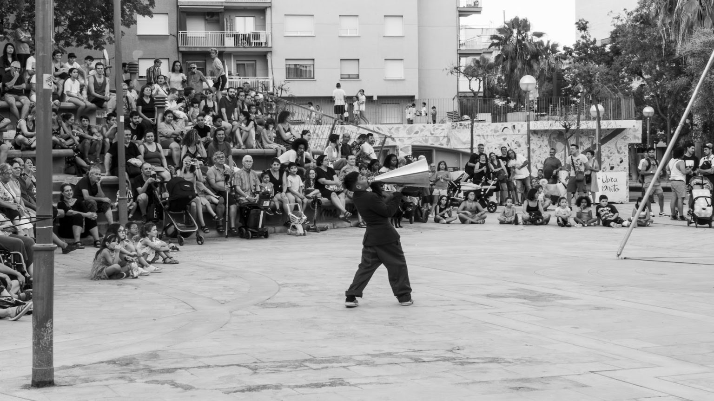

El circ és el gènere més difícil de fotografiar de tots els que treballem. No per la llum ni per l'equip, sinó perquè l'acció no espera: el salt dura un instant i el número no es repeteix. Qui arriba tard a la foto no la té.

Hem documentat la Mostra de Circ de Barcelona i espectacles de companyies catalanes, en carpes, naus i places. Treballem amb llum existent, sense flash, i amb un lloc pensat abans que comenci l'exercici. Sabem quan no es pot disparar i sabem quan cal callar.

  

## Per a qui treballem

- **Companyies de circ**: material de premsa, dossier i xarxes
- **Mostres i festivals**: cobertura oficial completa
- **Sales i carpes**: imatges per a programació i web
- **Circ de carrer**: documentació de festes majors i activitats populars

## Com treballem

Amb anticipació i sense intervenir. A les arts del moviment, la millor foto és la que no altera el número: ni flash, ni ruido, ni interrupcions.
