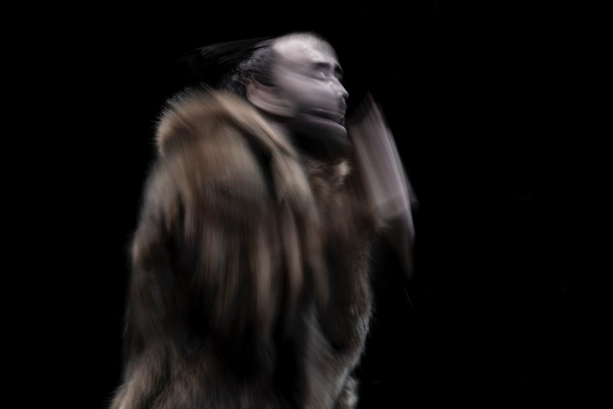
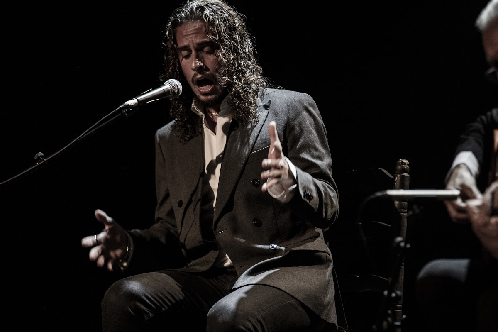

El flamenc no és només força: és temps. El compàs marca quan passa tot, i la foto que val la pena no és la del crit, sinó la de just abans. Portem anys documentant flamenc a Barcelona — el Ciutat Flamenco, el Districte Flamenco, Flamenco de Barrio, la Nau Bostik, el SAT! — i hem après a col·locar-nos on la llum i el gest coincideixen.

Treballar a prop del ball permet veure el que el públic no veu: la respiració abans del quejío, la mirada entre el cantaor i el ballarí, la mà que aguanta el compàs. Això és el que intentem capturar.

  
  

## Per a qui treballem

- **Festivals de flamenc**: cobertura oficial completa, amb entrega diària
- **Companyies i artistes**: material de premsa, dossier i xarxes
- **Tablaos i sales**: imatges per a programació i web
- **Escoles i entitats**: documentació d'actuacions i tallers

## Com treballem

Sense flash, amb llum existent, i sense interrompre el ball. En un tablao o en un teatre, el respecte al compàs és el mateix que el respecte al músic: no es pot arribar tard ni quedar-se al mig.
