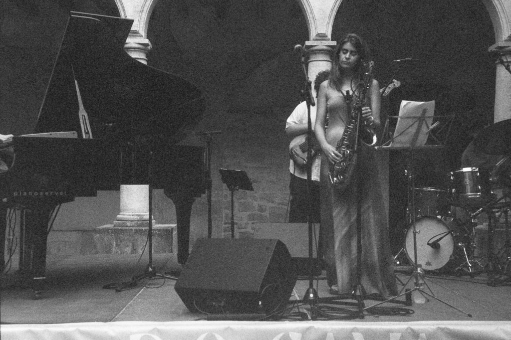
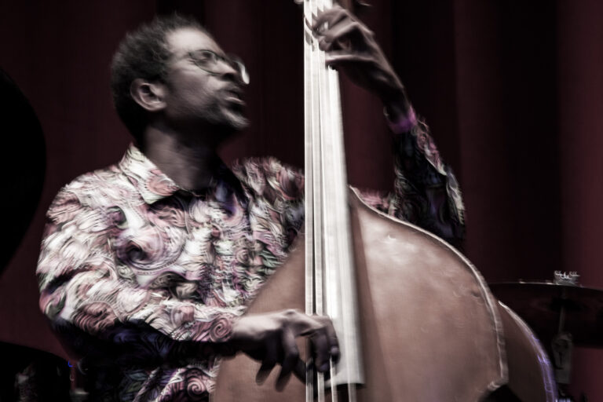
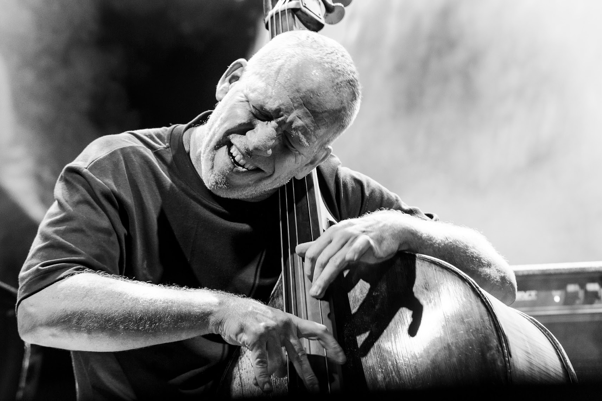

El jazz és el lloc on vaig començar a fotografiar música, i és on encara em sento més còmode. Un club fosc, un trio que no assaja el mateix solo dues nits seguides, i la sensació que si no dispares ara ja no hi serà. Això és el que intento capturar: no el músic posant, sinó el músic mentre pensa.

Portem més de vint anys documentant jazz i blues a Barcelona i Catalunya: el ViJazz de Vilafranca, el Jazz I Am, el Festival de Jazz de Barcelona, el Jamboree, sales de barri i festivals a l'aire lliure. Coneixem el repertori i els músics, i això canvia el resultat: saps quan ve el solo, qui mira qui, quan el bateria deixa caure el temps.

  
  
  

## Per a qui treballem

- **Clubs i sales de jazz**: documentació de nit, sense flash, amb el públic com a part de la foto
- **Festivals**: cobertura oficial amb entrega diària per a premsa i xarxes
- **Músics i bandes**: imatges per a disc, premsa i dossier de gira
- **Programadors**: material per vendre una temporada, no només un concert

## Com treballem

Amb llum existent sempre que sigui possible, sense interrompre el concert ni el públic. Per a nosaltres el respecte a l'escena no és una postura: és la condició perquè la foto existeixi.
