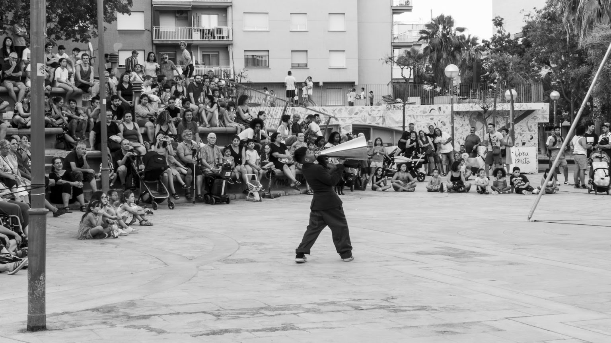

Circus is the hardest of all the disciplines we shoot. Not because of light or gear, but because the action will not wait: the jump lasts an instant and the act is never repeated. If you arrive late to the picture, you don't have it.

We have documented Mostra de Circ de Barcelona and shows by Catalan companies, in tents, warehouses and squares. We work with available light, no flash, and a position planned before the act begins. We know when you must not shoot, and we know when to stay quiet.

  

## Who we work for

- **Circus companies**: press, dossier and social media material
- **Showcases and festivals**: full official coverage
- **Venues and tents**: images for programming and website
- **Street circus**: documentation of neighbourhood fairs and public events

## How we work

With anticipation and without interfering. In movement arts, the best photograph is the one that does not alter the act: no flash, no noise, no interruptions.
