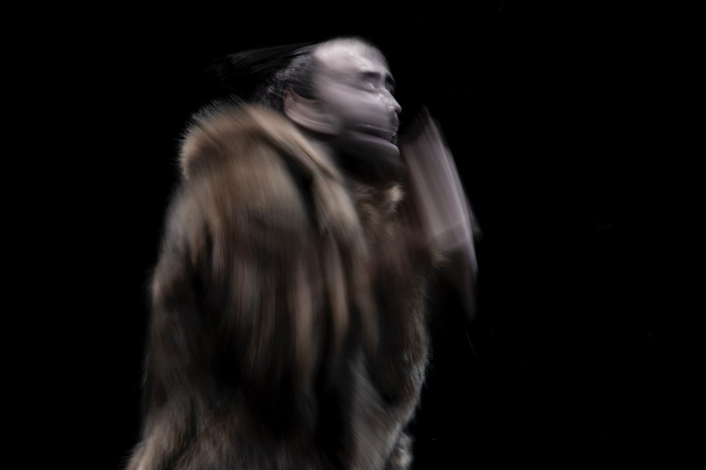
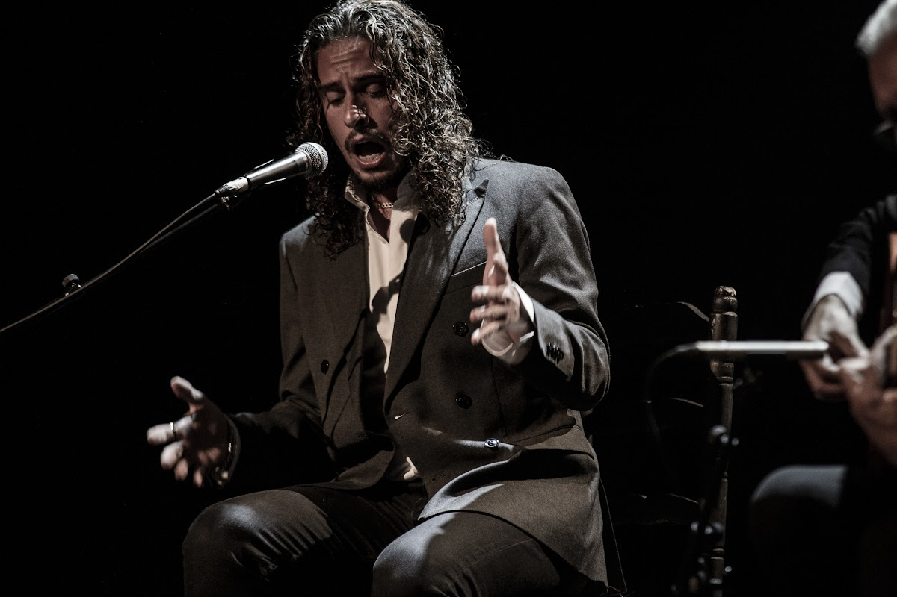

Flamenco is not only force: it is time. The compás marks when everything happens, and the picture worth taking is not the shout but the moment just before. We have been documenting flamenco in Barcelona for years — Ciutat Flamenco, Districte Flamenco, Flamenco de Barrio, Nau Bostik, SAT! — and we have learned to stand where light and gesture meet.

Working close to the dance lets you see what the audience does not: the breath before the quejío, the glance between singer and dancer, the hand that holds the compás. That is what we try to capture.

  
  

## Who we work for

- **Flamenco festivals**: full official coverage with daily delivery
- **Companies and artists**: press, dossier and social media material
- **Tablaos and venues**: images for programming and website
- **Schools and organisations**: documentation of performances and workshops

## How we work

No flash, available light, and never interrupting the dance. In a tablao or in a theatre, respect for the compás is the same as respect for the musician: you cannot arrive late or stand in the middle.
