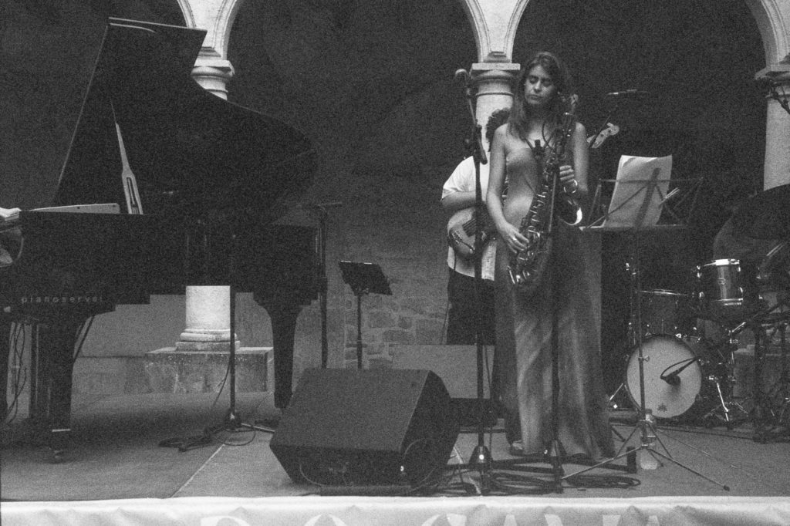
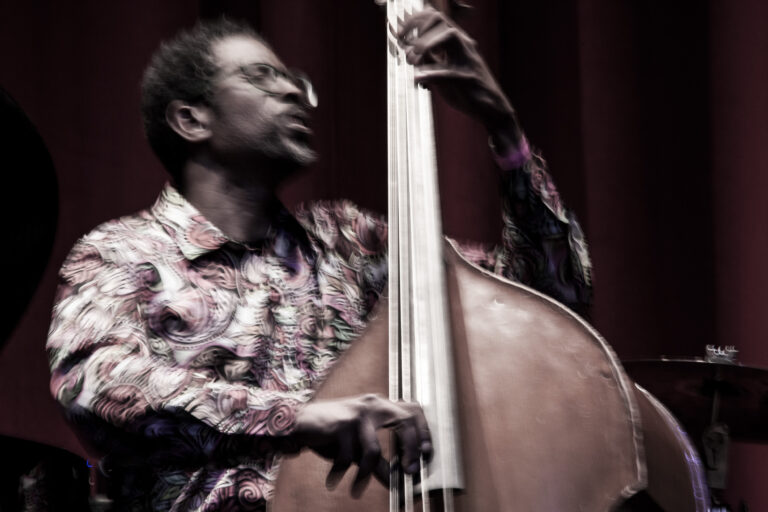
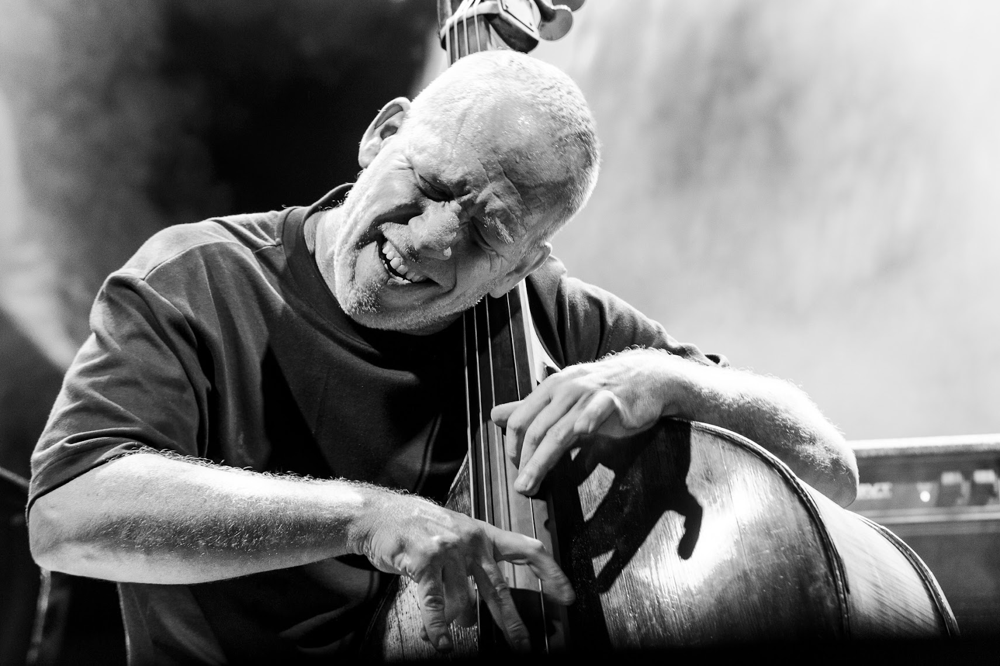

Jazz is where I started photographing music, and it is still where I feel most at home. A dark club, a trio that will not play the same solo two nights running, and the feeling that if you don't shoot now it will be gone. That is what I try to capture: not the musician posing, but the musician thinking.

We have spent more than twenty years documenting jazz and blues in Barcelona and Catalonia: ViJazz in Vilafranca, Jazz I Am, the Barcelona Jazz Festival, Jamboree, neighbourhood venues and open-air festivals. We know the repertoire and the players, and that changes the result: you know when the solo is coming, who is looking at whom, when the drummer drops the time.

  
  
  

## Who we work for

- **Jazz clubs and venues**: night documentation, no flash, with the audience as part of the picture
- **Festivals**: official coverage with daily delivery for press and social media
- **Musicians and bands**: images for records, press and tour dossiers
- **Programmers**: material to sell a season, not just one concert

## How we work

Available light whenever possible, without interrupting the concert or the audience. Respect for the stage is not a pose for us: it is the condition for the photograph to exist.
