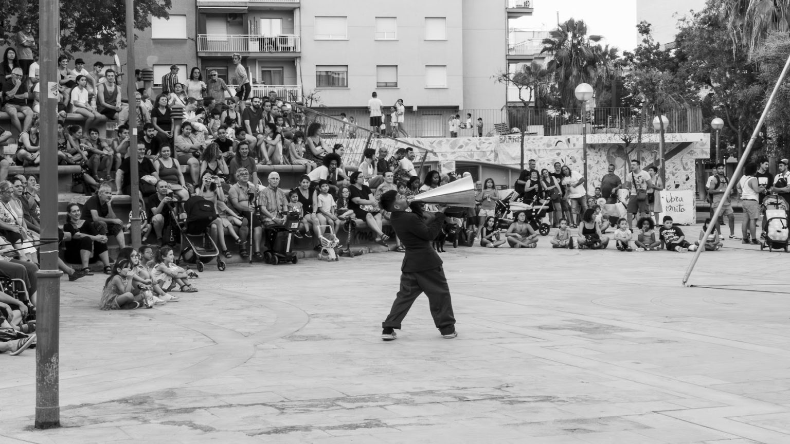

El circo es el género más difícil de fotografiar de todos los que trabajamos. No por la luz ni por el equipo, sino porque la acción no espera: el salto dura un instante y el número no se repite. Quien llega tarde a la foto no la tiene.

Hemos documentado la Mostra de Circ de Barcelona y espectáculos de compañías catalanas, en carpas, naves y plazas. Trabajamos con luz existente, sin flash, y con un sitio pensado antes de que empiece el ejercicio. Sabemos cuándo no se puede disparar y sabemos cuándo hay que callar.

  

## Para quién trabajamos

- **Compañías de circo**: material de prensa, dossier y redes
- **Muestras y festivales**: cobertura oficial completa
- **Salas y carpas**: imágenes para programación y web
- **Circo de calle**: documentación de fiestas mayores y actividades populares

## Cómo trabajamos

Con anticipación y sin intervenir. En las artes del movimiento, la mejor foto es la que no altera el número: ni flash, ni ruido, ni interrupciones.
