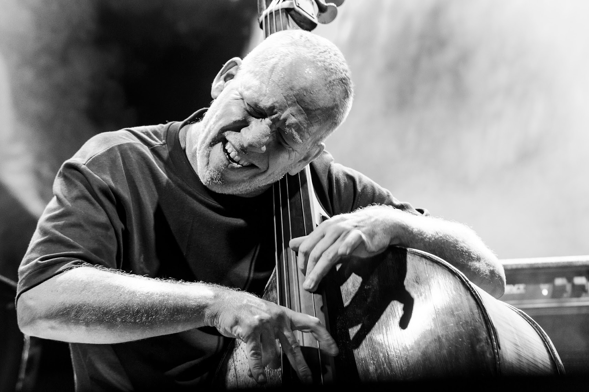
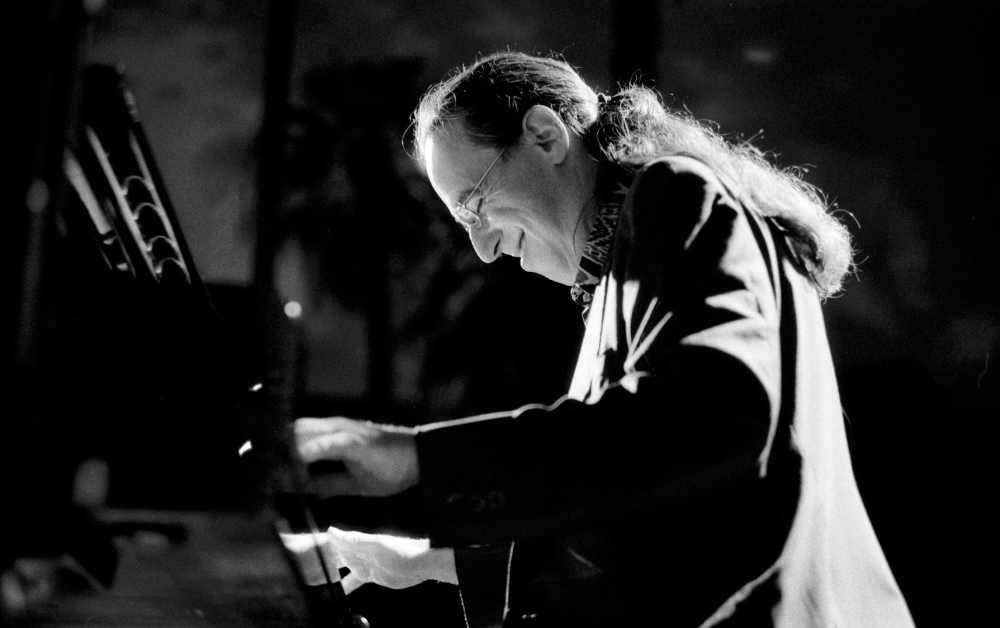
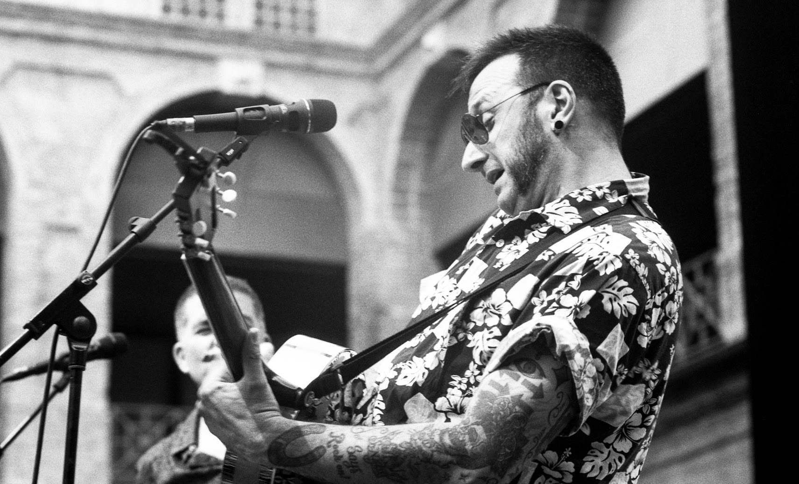
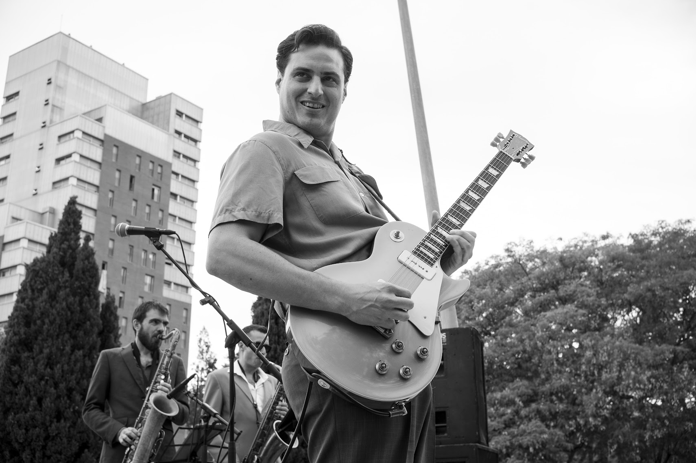
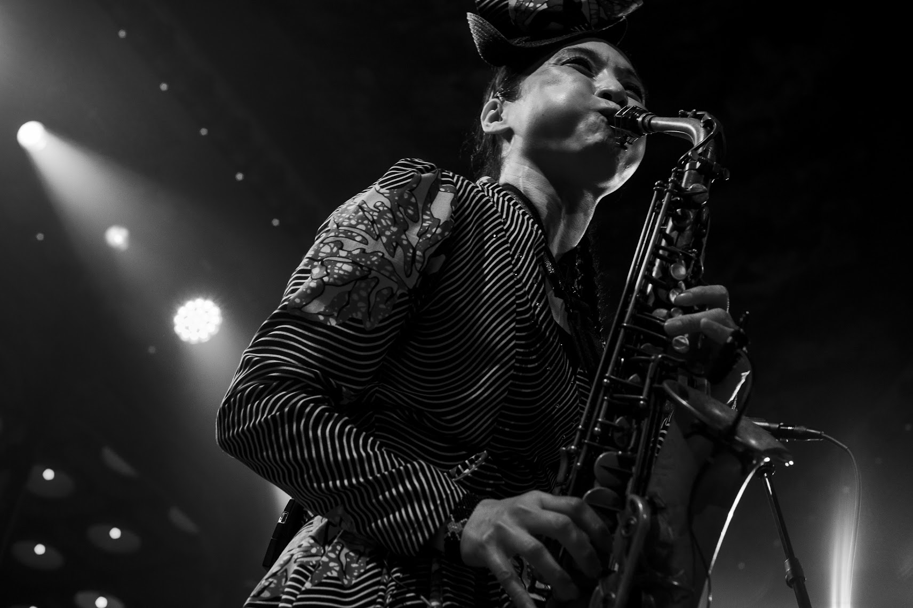
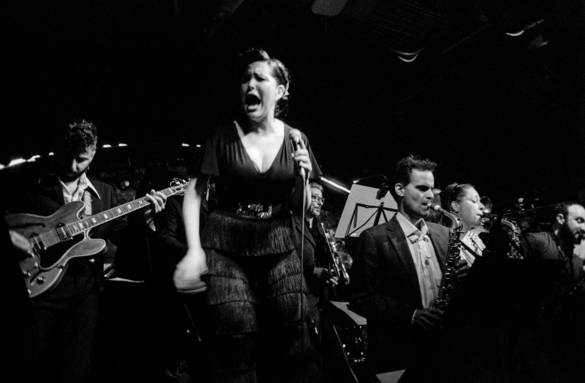

Un concierto no se puede repetir. La luz cambia cada segundo, el músico se mueve, el momento se acaba. O estabas en el punto exacto o no. Llevamos más de veinte años aprendiendo a estar — en clubs de jazz, en festivales al aire libre, en escenarios grandes y pequeños, en salas donde la luz es la última de las preocupaciones del organizador. Desde 2002 hemos documentado la música en directo en Barcelona y Cataluña: el Festival de Blues de Barcelona, ViJazz Vilafranca, conciertos en el Jamboree, en el Palau de la Música y en decenas de salas alternativas.

  
  
  
  
  
  

## ¿Qué situaciones cubrimos?

Trabajamos con cualquier formato de música en directo en Barcelona y en toda Cataluña:

- **Clubs y salas de concierto**: desde el Jamboree y la Sala Apolo hasta bares de jazz y salas alternativas de barrio
- **Festivales de música**: cobertura oficial de festivales de jazz, blues, flamenco, folk, electrónica y música clásica
- **Presentaciones de disco**: documentación del directo y material para prensa y redes sociales

## ¿Qué entregamos?

Un archivo editado y listo para usar: selección de imágenes en alta resolución para prensa, versiones optimizadas para web y redes, y todos los originales. Entrega en 48-72 horas según el volumen del evento.
