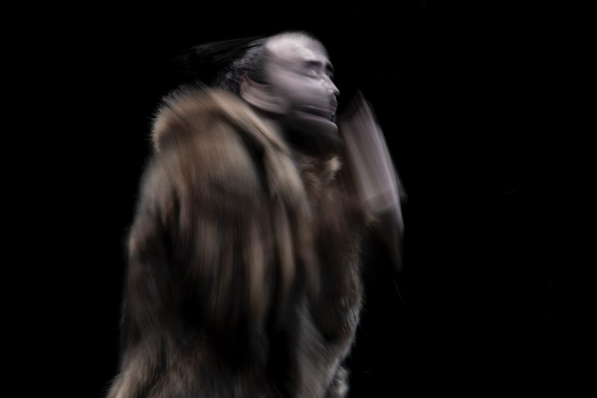
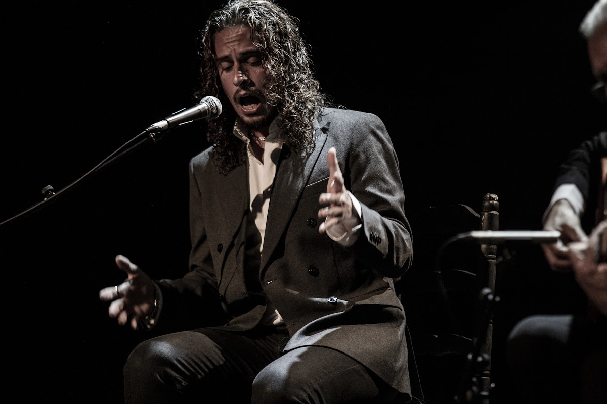

El flamenco no es solo fuerza: es tiempo. El compás marca cuándo pasa todo, y la foto que vale la pena no es la del grito, sino la de justo antes. Llevamos años documentando flamenco en Barcelona — el Ciutat Flamenco, el Districte Flamenco, Flamenco de Barrio, la Nau Bostik, el SAT! — y hemos aprendido a colocarnos donde la luz y el gesto coinciden.

Trabajar cerca del baile permite ver lo que el público no ve: la respiración antes del quejío, la mirada entre el cantaor y el bailaor, la mano que sostiene el compás. Eso es lo que intentamos capturar.

  
  

## Para quién trabajamos

- **Festivales de flamenco**: cobertura oficial completa, con entrega diaria
- **Compañías y artistas**: material de prensa, dossier y redes
- **Tablaos y salas**: imágenes para programación y web
- **Escuelas y entidades**: documentación de actuaciones y talleres

## Cómo trabajamos

Sin flash, con luz existente, y sin interrumpir el baile. En un tablao o en un teatro, el respeto al compás es el mismo que el respeto al músico: no se puede llegar tarde ni quedarse en medio.
