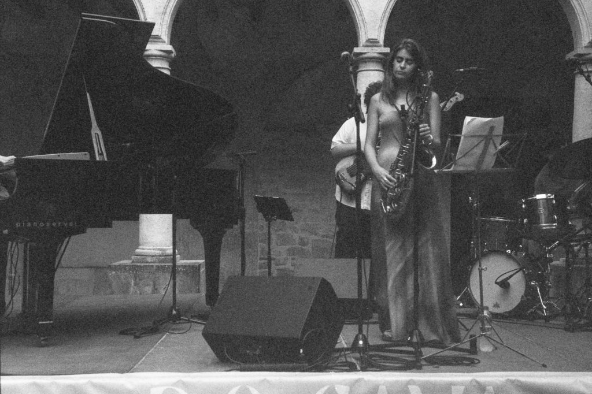
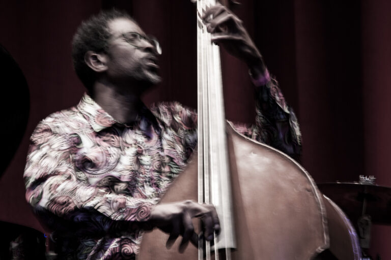
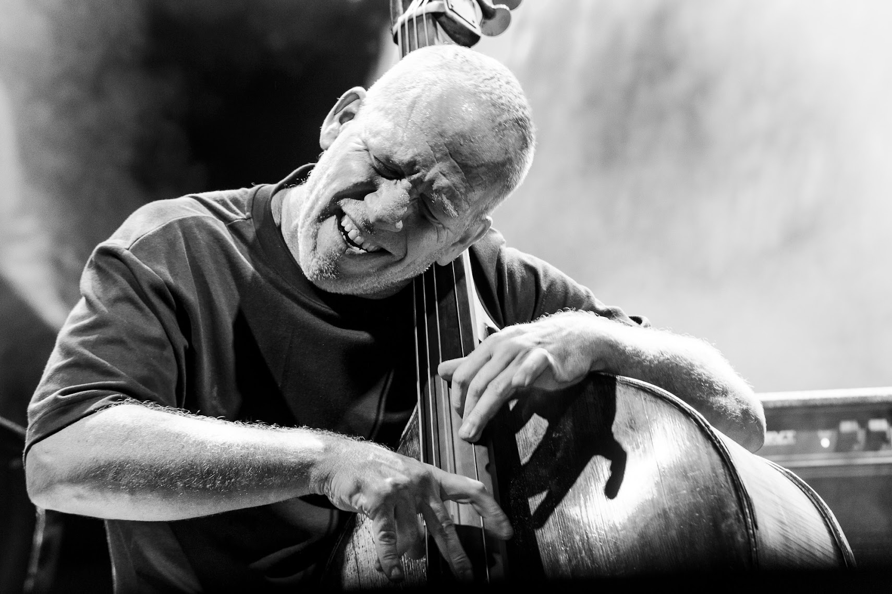

El jazz es donde empecé a fotografiar música, y es donde todavía me siento más cómodo. Un club oscuro, un trío que no ensaya el mismo solo dos noches seguidas, y la sensación de que si no disparas ahora ya no estará. Eso es lo que intento capturar: no al músico posando, sino al músico mientras piensa.

Llevamos más de veinte años documentando jazz y blues en Barcelona y Cataluña: el ViJazz de Vilafranca, Jazz I Am, el Festival de Jazz de Barcelona, el Jamboree, salas de barrio y festivales al aire libre. Conocemos el repertorio y a los músicos, y eso cambia el resultado: sabes cuándo llega el solo, quién mira a quién, cuándo el batería deja caer el tiempo.

  
  
  

## Para quién trabajamos

- **Clubs y salas de jazz**: documentación de noche, sin flash, con el público como parte de la foto
- **Festivales**: cobertura oficial con entrega diaria para prensa y redes
- **Músicos y bandas**: imágenes para disco, prensa y dossier de gira
- **Programadores**: material para vender una temporada, no solo un concierto

## Cómo trabajamos

Con luz existente siempre que sea posible, sin interrumpir el concierto ni al público. Para nosotros el respeto al escenario no es una postura: es la condición para que la foto exista.
